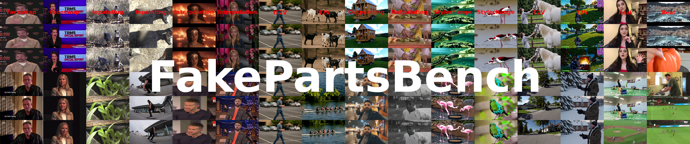
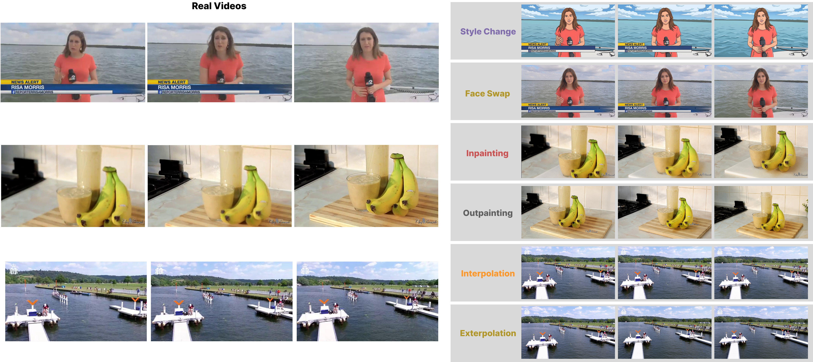
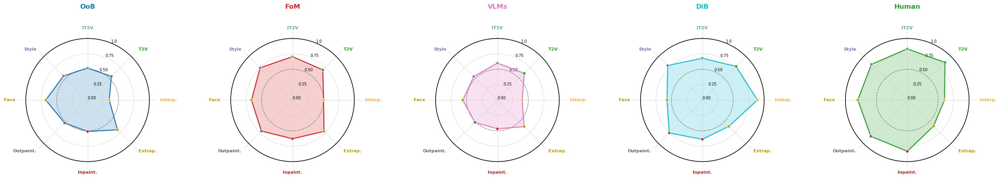

<h1 align="center">[NeurIPS'26] FakeParts: A New Family of AI-Generated Video Forgeries</h1>

<p align="center">
  <a href="https://github.com/hi-paris/FakeParts"></a>
  <a href="https://huggingface.co/datasets/hi-paris/FakeParts"></a>
  <a href="https://arxiv.org/abs/2508.21052"></a>
  <a href="https://opensource.org/licenses/BSD-3-Clause"></a>
</p>

<p align="center">
  <a href="https://ziyiliu.top/"><strong>Ziyi Liu</strong></a><sup>1,*</sup> &ensp;·&ensp;
  <strong>Firas Gabetni</strong><sup>3,*</sup> &ensp;·&ensp;
  <strong>Awais Hussain Sani</strong><sup>1,*</sup>
  <br/>
  <strong>Xi Wang</strong><sup>2,*</sup> &ensp;·&ensp;
  <strong>Soobash Daiboo</strong><sup>1</sup> &ensp;·&ensp;
  <strong>Gaëtan Brison</strong><sup>1</sup>
  <br/>
  <a href="https://giannifranchi.github.io/"><strong>Gianni Franchi</strong></a><sup>3,†</sup> &ensp;·&ensp;
  <a href="https://vicky.kalogeiton.info/"><strong>Vicky Kalogeiton</strong></a><sup>2,†</sup>
</p>

<p align="center">
  <sup>1</sup>Hi! PARIS, Institut Polytechnique de Paris, Palaiseau, France<br>
  <sup>2</sup>LIX, École Polytechnique, CNRS, Institut Polytechnique de Paris, Palaiseau, France<br>
  <sup>3</sup>U2IS, ENSTA Paris, Institut Polytechnique de Paris, Palaiseau, France<br>
  <sup>*</sup>Equal Contribution. &nbsp; <sup>†</sup>Equal supervision.
</p>



## Contents

- [Overview](#overview)
- [Dataset](#dataset)
- [Generation](#generation)
- [Detection and results](#detection-and-results)
- [Installation](#installation)
- [Download the dataset](#download-the-dataset)
- [Run generation](#run-generation)
- [Run detection](#run-detection)
- [Evaluate results](#evaluate-results)
- [Names and IDs](#names-and-ids)
- [Project structure](#project-structure)
- [Citation and license](#citation-and-license)
- [Acknowledgements](#-acknowledgements)
- [Contact](#-contact)

## Overview

**FakePartsBench** brings full-video synthesis and partial video manipulation into a
single benchmark. It contains **85,115 videos: 18,301 real and 66,814 fake**, with **20,392 full fakes and 46,422
partial fakes**. The accompanying code provides
method-specific generation and detection adapters, dataset metadata tools, and
ROC-AUC, VBench, and FVD evaluation scripts.

Our paper was accepted to the **NeurIPS 2026 Evaluations and Datasets Track**.
Read the [paper](https://arxiv.org/abs/2508.21052) and explore the
[dataset card](https://huggingface.co/datasets/hi-paris/FakeParts) for benchmark
construction, annotations, and source attribution.

## Dataset

| Task          |     Videos | Methods or sources                                                                                  |
|---------------|-----------:|-----------------------------------------------------------------------------------------------------|
| T2V           |     16,412 | Sora (1080p/720p), OpenSora, CogVideoX, AllegroAI, Mochi-1, LTX-Video, HunyuanVideo, Veo 2, Wan 2.1 |
| IT2V          |      3,980 | OpenSora, Wan 2.1                                                                                   |
| Style         |      5,266 | RAVE, AnyV2V                                                                                        |
| FaceSwap      |      7,069 | InsightFace, LivePortrait, HunyuanPortrait                                                          |
| Inpainting    |     13,577 | ProPainter, ROVI, DiffuEraser                                                                       |
| Outpainting   |      7,275 | Akira                                                                                               |
| Interpolation |     10,000 | Framer                                                                                              |
| Extrapolation |      3,235 | Cosmos-Predict2                                                                                     |
| Real          |     18,301 | TenK Real YouTube, YouTube VOS 2019                                                                 |
| **Total**     | **85,115** | **23 fake task–method groups and 2 real sources**                                                   |



The dataset is distributed separately on
[Hugging Face](https://huggingface.co/datasets/hi-paris/FakeParts).
`metadata.jsonl` is the canonical index: each row identifies a video by
`sample_id`, relative `file_name`, label, task, method, measured video properties,
and inclusive, zero-based `real_frames` / `fake_frames` ranges. Per-method
JSONL manifests link samples to retained inputs and provenance. Spatial source
masks, prompts, conditioning images, frame sequences, and source videos are
organised under `assets/`; availability is recorded in the manifests. Source
masks and temporal frame tags describe different annotation types.

```text
FakePartsBench/
├── metadata.jsonl
├── croissant.json
├── fake/<task>/<method>/*.mp4
├── real/<source>/*.mp4
├── manifests/<task>__<method>.jsonl
└── assets/                         # Source inputs and provenance
```

Use the metadata index to select benchmark samples. Media under `assets/` are
reference inputs, separate from the benchmark video inventory.

## Generation


The generation runner dispatches adapters for the open-source methods listed
above. Each adapter defines its required inputs: prompts, conditioning images,
driving videos, masks, edited first frames, or camera trajectories. Sora and
Veo 2 outputs are included in the dataset; their proprietary generators are
not implemented in this repository.

See the [generation guide](fakeparts/generation/README.md) and
[generator registry](fakeparts/generation/config.py) for model IDs, input
contracts, upstream environments, and checkpoint sources.

## Detection and results

We organise 20 detectors into four families:

| Family                       | Detectors                                    |
|------------------------------|----------------------------------------------|
| Out-of-the-box (OoB)         | CNNDet, HiFi, TALL, NPR, AIGV, IML-ViT, TFCU |
| Foundation models (FoM)      | De-Fake, UnivFD, FatFormer, D³, C2P, DFD-FCG |
| Vision-language models (VLM) | MM-Det, FakeVLM, SIDA, AFPrompt, BusterX     |
| Diffusion-based (DiB)        | DRCT, NSG-VD                                 |



The [detection guide](fakeparts/detection/README.md) lists supported checkpoint
versions and their sources. [Pipeline details](fakeparts/detection/README.md#pipelines)
describe preprocessing, frame/clip sampling, and score aggregation. Use the
paper for the reported experimental results; reruns depend on the selected
checkpoint, sample coverage, and evaluation settings.

## Installation

Run the commands below from the repository root. The shared package currently
requires **Python 3.14 or newer**, as specified in
[`pyproject.toml`](pyproject.toml), and uses CUDA-enabled PyTorch. Install
[uv](https://docs.astral.sh/uv/) first; GPU inference also requires a compatible
NVIDIA driver. Individual upstream models may need a separate Python/CUDA
environment; follow their component guides.

```bash
git clone https://github.com/hi-paris/FakeParts.git
cd FakeParts
git submodule update --init --recursive

uv venv --python 3.14
source .venv/bin/activate
uv pip install -e .
```

Prepare only the model checkpoints you intend to use:

```bash
bash scripts/set_up_generator.sh --help
bash scripts/set_up_generator.sh --methods insightface

bash scripts/set_up_detector.sh --help
bash scripts/set_up_detector.sh --methods cnndet:blur_jpg_prob0_5
```

The shared generator setup currently supports InsightFace; use the upstream
instructions linked in the generation guide for other methods. Third-party
checkpoints are obtained separately under their own terms. To run a shell
entry point with a particular environment, set `FAKEPARTS_PYTHON` to its Python
executable.

## Download the dataset

Preview the index and manifests without downloading the videos:

```python
from huggingface_hub import snapshot_download

snapshot_download(
    repo_id="hi-paris/FakeParts",
    repo_type="dataset",
    local_dir="FakePartsBench",
    allow_patterns=["README.md", "metadata.jsonl", "croissant.json", "manifests/*"],
)
```

Download the complete dataset, including videos and retained source assets:

```python
from huggingface_hub import snapshot_download

snapshot_download(
    repo_id="hi-paris/FakeParts",
    repo_type="dataset",
    local_dir="FakePartsBench",
)
```

For on-demand access and streaming examples, see the
[dataset card](https://huggingface.co/datasets/hi-paris/FakeParts#-access-the-dataset).
Download metadata and the relevant `file_name` paths together when selecting a
subset. You can supply a dataset stored elsewhere through the runners' input
options.

## Run generation

List supported models and inspect their required inputs:

```bash
python scripts/generate.py --list-models
bash scripts/generate.sh --help
```

Generate with Wan 2.1 from a prompt file:

```bash
bash scripts/generate.sh \
  --model wan21:t2v --input path/to/prompt.txt \
  --output-dir results/generation/wan21
```

Generate from an image and a prompt:

```bash
bash scripts/generate.sh \
  --model wan21:it2v --input path/to/image.png \
  --prompt "A person walking through a garden" \
  --output-dir results/generation/wan21
```

Use a dataset manifest for batch generation:

```bash
bash scripts/generate.sh \
  --model framer \
  --manifest FakePartsBench/manifests/interpolation__framer.jsonl \
  --output-dir results/generation/framer \
  --limit 1 --strict --dry-run
```

Remove `--dry-run` to execute after preparing the model environment, checkpoints,
and required source assets. Relative manifest input paths resolve against the
dataset root. `--strict` rejects rows without the required inputs;
`--skip-existing` resumes batches by skipping nonempty output videos.

## Run detection

List adapters and checkpoint variants:

```bash
bash scripts/detect.sh --list-models
bash scripts/detect.sh --help
```

Run on the benchmark, including its real control videos:

```bash
bash scripts/detect.sh \
  --det-family oob --det-method cnndet \
  --det-version blur_jpg_prob0_5 \
  --input FakePartsBench \
  --output-dir results/oob/cnndet
```

`--input` also accepts a video, folder, or JSONL. Use `--sample-label`,
`--sample-task`, `--sample-method`, and `--sample-id` to select samples. For
example, add `--sample-task interpolation --sample-method framer` to select
that fake group; retain scored real videos for ROC-AUC evaluation.

Results are grouped into CSVs such as
`interpolation_framer.blur_jpg_prob0_5.csv` and
`real_tenk_youtube.blur_jpg_prob0_5.csv`. Every filename has an explicit
checkpoint-version suffix, including `.default.csv` where applicable. The
runner resumes existing output CSVs. Decoded frames are cached under `/tmp`;
`--frame-cache-dir` selects a different cache location.

Run scripts directly with `bash`, or submit the same scripts from the repository
root with `sbatch`. Set Slurm resources before the script path. For example:

```bash
sbatch --partition=GPU --gpus=1 scripts/detect.sh \
  --det-family oob --det-method cnndet \
  --det-version blur_jpg_prob0_5 \
  --input FakePartsBench \
  --output-dir results/oob/cnndet
```

Set the partition and resource options for your cluster.

## Evaluate results

Compute ROC-AUC from existing fake and real prediction CSVs:

```bash
bash scripts/evaluate/auc.sh --method cnndet:blur_jpg_prob0_5 --seed 0

# Recompute all available detector summaries and aggregate tables.
bash scripts/evaluate/auc.sh --all results/
```

AUC evaluation averages frame scores per video where applicable and uses
version-matched real predictions. It samples an equally sized real control set
for each fake task–method group, using replacement when the real pool is smaller.
Per-detector summaries are written under `results/<family>/<detector>.csv`;
combined tables are `results/auc.csv` and `results/auc_cate.csv`. The latter
contains macro-averages across detector families and generator categories.

Prepare the video-quality evaluation environment and run VBench or FVD:

```bash
bash scripts/evaluate/set_up.sh

bash scripts/evaluate/vbench.sh \
  --input-jsonl FakePartsBench/manifests/t2v__wan21.jsonl

bash scripts/evaluate/fvd.sh \
  --input-jsonl FakePartsBench/manifests/t2v__wan21.jsonl \
  --real-dir FakePartsBench/real --fakeparts-only \
  --n-samples 1000
```

VBench reports subject consistency, temporal flickering, and imaging quality.
The FVD example computes `FVD_FP` against the benchmark real videos. Remove
`--fakeparts-only` to also compute `FVD_W`; the wrapper retrieves WebVid
references through its configured `--webvid-dataset` and `--webvid-split`.
The wrapper defaults to the number of fake videos in the input JSONL; choose
`--n-samples` to fit both the generated set and the distinct real-reference pool.
The shell scripts save outputs under `results/eval/` and can also be submitted
with `sbatch`. See the [evaluation guide](fakeparts/evaluation/README.md) for
sampling settings, checkpoint requirements, and result formats.

## Project structure

```text
FakeParts/
├── assets/                 # Figures used in this README
├── fakeparts/
│   ├── detection/          # Detector registry and inference adapters
│   ├── evaluation/         # FVD and VBench runners
│   ├── generation/         # Generator registry and inference adapters
│   └── naming.py           # Canonical task, method, and detector IDs
├── scripts/
│   ├── evaluate/           # AUC, FVD, and VBench commands
│   ├── detect.py           # Detection runner
│   ├── generate.py         # Generation runner
│   └── set_up_*.py         # Checkpoint and environment setup
├── FakePartsBench/         # Dataset files (download separately)
├── ckpt/                   # Model checkpoints (prepare separately)
├── pyproject.toml
└── LICENSE
```

## Citation and license

```bibtex
@inproceedings{liu2026fakeparts,
    title = {FakeParts: A New Family of {AI}-Generated Video Forgeries},
    author = {Liu, Ziyi and Gabetni, Firas and Sani, Awais Hussain and Wang, Xi and Daiboo, Soobash and Brison, Gaetan and Franchi, Gianni and Kalogeiton, Vicky},
    booktitle = {The Fortieth Annual Conference on Neural Information Processing Systems Evaluations and Datasets Track},
    year = {2026},
    url = {https://arxiv.org/abs/2508.21052}
}
```

Our original code and authored materials are released under the
[BSD 3-Clause License](LICENSE). Third-party implementations and checkpoints
retain their upstream licenses. Dataset metadata, manifests, and original
FakePartsBench materials use BSD 3-Clause; source videos, images, masks, and
other third-party media remain subject to their original licenses and platform
terms. See the [dataset license notes](https://huggingface.co/datasets/hi-paris/FakeParts#-data-and-licence-notes)
and component guides for source-specific terms.

## 💡 Acknowledgements

This work was conducted at Hi! PARIS, Institut Polytechnique de Paris, LIX (École Polytechnique), and U2IS (ENSTA
Paris).

We thank the authors and teams behind Sora, Veo2, Allegro, CogVideoX, HunyuanVideo, LTX-Video, Mochi, Open-Sora, Wan
2.1, Cosmos-Predict2, HunyuanPortrait, LivePortrait, InsightFace, AnyV2V, RAVE, Framer, DiffuEraser, ProPainter, ROVI,
and AKiRa; the authors of the evaluated detectors CNNDetection, HiFi-IFDL, TALL, NPR, AIGVDet, IML-ViT, TFCU, De-Fake,
UniversalFakeDetect, FatFormer, D3, C2P, DFD-FCG, MM-Det, FakeVLM, SIDA, AntifakePrompt, BusterX, DRCT, and NSG-VD; and
the teams behind VBench and Content-Debiased FVD. We also thank the maintainers and contributors of TenK YouTube, DAVIS,
YouTube-VOS, MOSE, LVD-2M, and Animal Kingdom.

A special thanks to the DeepMind team working on Veo2 and Veo3 for granting us early API access.

## 💬 Contact

You are welcome to open an [issue](https://github.com/hi-paris/FakeParts/issues)
or [pull request](https://github.com/hi-paris/FakeParts/pulls).
